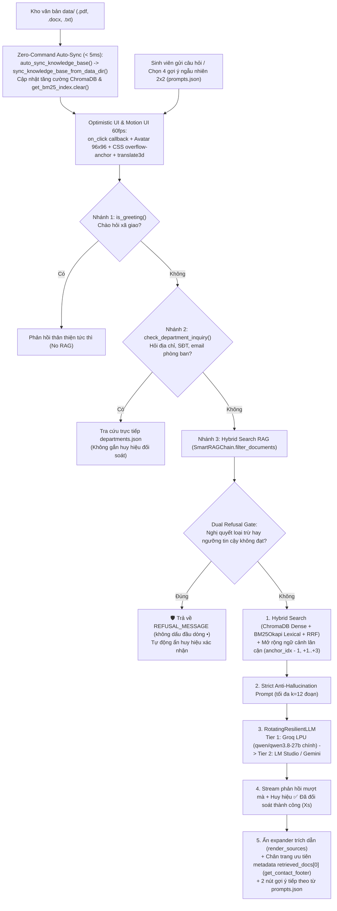

# 🎓 VLUTEBOT - Trợ lý Lucas
### Hệ thống AI Tra cứu Quy chế Đào tạo & Quy định Sinh viên - Trường Đại học Công nghệ Kỹ thuật Vĩnh Long

[](https://streamlit.io/)
[](https://www.langchain.com/)
[](https://www.trychroma.com/)
[](https://groq.com/)
[](https://lmstudio.ai/)
[](https://huggingface.co/bkai-foundation-models/vietnamese-bi-encoder)

---

## 📌 Giới thiệu Dự án
**VLUTEBOT (Trợ lý Lucas)** là ứng dụng hỏi đáp thông minh ứng dụng kỹ thuật **Dynamic RAG (Retrieval-Augmented Generation)**, được thiết kế chuyên biệt cho sinh viên và cán bộ **Trường Đại học Công nghệ Kỹ thuật Vĩnh Long (VLUTE - tiền thân: Trường ĐH Sư phạm Kỹ thuật Vĩnh Long)**.

Hệ thống sử dụng mô hình nhúng tiếng Việt `bkai-foundation-models/vietnamese-bi-encoder` qua `HuggingFaceEmbeddings`, lưu trữ trong **ChromaDB** (`386` đoạn văn bản từ `7` quy chế chính thức) và suy luận đa tầng qua **`RotatingResilientLLM`** (ưu tiên **Groq LPU**, dự phòng **Local LM Studio `qwen/qwen3.5-4b`** và **Gemini**).

Các nhóm quy chế được hỗ trợ tra cứu trực tiếp:
- 🏆 **Học bổng & Khen thưởng:** Tiêu chuẩn, điều kiện tín chỉ, mức học bổng KKHT/SPKT và học bổng vượt khó (**QĐ 201**).
- 💰 **Học phí & Chính sách:** Chế độ miễn giảm học phí, hỗ trợ chi phí học tập (**QĐ 904**) và quy trình hoàn trả học phí thừa (**QT-SV-04**).
- 🤝 **Công tác xã hội (CTXH):** Số ngày tích lũy, phân bổ theo năm học, điều kiện làm khóa luận/tốt nghiệp và quy đổi hoạt động (**QĐ 55**).
- 📋 **Quy chế Công tác sinh viên:** Quyền và nghĩa vụ sinh viên, kỷ luật, chấm dứt hiệu lực kỷ luật và Ban cán sự lớp (**QĐ 1079**).
- 🛡️ **Quy tắc ứng xử & An toàn thông tin:** Văn hóa học đường, trang phục thực hành (**QĐ 367**), mật khẩu, email `@st.vlute.edu.vn` và an ninh mạng (**QĐ 979**).

---

## 🏗️ Kiến trúc Kỹ thuật & Cơ chế Chống Ảo giác



### Các điểm nhấn kiến trúc hiện tại:
1. **3 nhánh xử lý tách bạch trong `app.py`:**
   - **Nhánh 1 (`is_greeting`):** Phản hồi chào hỏi nhanh không cần gọi RAG.
   - **Nhánh 2 (`check_department_inquiry`):** Đọc trực tiếp dữ liệu địa điểm, điện thoại, email từ `departments.json`; tự động bỏ qua các câu hỏi thủ tục/quy chế (`"hồ sơ"`, `"thủ tục"`, `"điều kiện"`, `"miễn giảm"`, `"học bổng"`, `"quy trình"`, `"quy định"`, `"mức"`) để đi đúng vào luồng RAG.
   - **Nhánh 3 (Hybrid Search RAG):** Chỉ truy xuất văn bản khi thực sự là câu hỏi nghiệp vụ/quy chế.
2. **Tự động đồng bộ kho văn bản không cần lệnh terminal (`Zero-Command Auto-Sync` trong `ingest.py` & `rag.py`):**
   - **Đa định dạng tài liệu (`.pdf`, `.docx`, `.txt`):** Ngoài `.pdf` (`PyMuPDF`), `ingest.py` hỗ trợ đọc `.docx` qua `python-docx` (trích xuất cả đoạn văn và bảng biểu `table`, khử lặp ô gộp) và tệp văn bản thuần `.txt`.
   - **Tự nhận diện phòng ban & metadata:** `match_department_for_file(filename, departments, content_preview="")` quét thêm tối đa `1.500` ký tự đầu nội dung văn bản để tự động gán đúng phòng ban (`dao_tao`, `ctsv`, `khtc`, `cntt`), kể cả khi tệp mới đặt tên chung (ví dụ `thong_bao_2026.pdf`); đồng thời tự bóc tách `title`, `year`, `doc_code` (gồm `QĐ`, `QT`, `HD`, `KH`, `TB`) và `file_mtime`.
   - **Đồng bộ tăng cường tức thì (`sync_knowledge_base_from_data_dir` & `auto_sync_knowledge_base`):** Mỗi khi ứng dụng khởi tạo/tải lại trang, kiểm tra chữ ký thư mục `data/` qua `os.scandir` (chỉ mất `< 5 ms` khi không có thay đổi; đo thực tế `0.452 ms`). Khi phát hiện tệp mới thêm, bị sửa (`file_mtime` đổi) hoặc bị xóa khỏi `data/`, hệ thống tự động gọi `vector_db.add_documents()` / `vector_db.delete(where={"source": ...})` (giữ nguyên toàn bộ dữ liệu cũ không đổi), đặt `_GLOBAL_BM25_DATA = None` và gọi `get_bm25_index.clear()` để cả Dense Vector lẫn BM25 RRF cập nhật ngay mà **không hiển thị nút upload tệp** lên giao diện sinh viên.
3. **Conversational Query Rewriting (`rewrite_conversational_query` trong `rag.py`):**
   - Tự động giữ nguyên câu hỏi gốc khi lịch sử trống hoặc câu hỏi đã đủ chủ ngữ để tránh tăng độ trễ.
   - Khi phát hiện đại từ/từ nối ngữ cảnh (`"nó"`, `"cái đó"`, `"mức này"`, `"vậy thì"`, `"còn hồ sơ"`, `"như thế nào"`...), lấy 2–3 lượt hội thoại gần nhất và dùng `RotatingResilientLLM` (`temperature=0.0, max_tokens=120`) viết lại thành câu hỏi độc lập trước khi truyền vào `SmartRAGChain.filter_documents()` và `get_contact_footer()`, đồng thời vẫn hiển thị nguyên văn câu hỏi gốc trên bong bóng chat.
4. **Hybrid Search tổng quát với RRF (`SmartRAGChain.filter_documents` trong `rag.py`):**
   - Kết hợp **Dense Vector Search** (`ChromaDB` + `bkai-foundation-models/vietnamese-bi-encoder`) và **Lexical Search** (`rank_bm25.BM25Okapi`, cache một lần qua `@st.cache_resource`) bằng công thức **Reciprocal Rank Fusion (RRF)** áp dụng đồng nhất cho toàn bộ tài liệu hiện có và tương lai (không rẽ nhánh cứng theo từng tệp hay từng câu hỏi).
   - **Mở rộng đoạn lân cận (`anchor_idx - 1`, `+1`, `+2`, `+3`):** Tự động gom các đoạn liền kề trên cùng trang/bảng PDF tách cột (như phụ lục quy đổi ngày CTXH QĐ 55 hoặc khung xử lý kỷ luật QĐ 1079) và áp dụng **Dual Refusal Gate** (`SIMILARITY_THRESHOLD = 0.38`, kết hợp độ phủ từ khóa/điểm RRF).
   - Loại bỏ hoàn toàn các nghị quyết hành chính (`nghi_quyet_71.pdf`, `nghi_quyet_72.pdf`, `nghi_quyet_153.pdf`) khỏi kết quả và danh sách ingest (`EXCLUDED_FILES`).
5. **`RotatingResilientLLM` đa tầng chịu lỗi & Caching tài nguyên (`@st.cache_resource`):**
   - **Tier 1 (Chính):** **Groq LPU** với cơ chế giữ ấm client (`_GROQ_CLIENTS_CACHE`), bỏ qua nhanh model không khả dụng (`_DEAD_GROQ_MODELS`), ưu tiên model phản hồi nhanh không tiêu tốn token suy luận **`qwen/qwen3.8-27b`** (`max_output_tokens=2048`), dự phòng `openai/gpt-oss-120b` / `openai/gpt-oss-20b` (cấu hình tường minh `reasoning_effort="low"`, `max_tokens >= 2500` để chống cắt cụt câu trả lời) và các model khác.
   - **Tier 2 (Dự phòng 1):** **Local LM Studio** (`http://127.0.0.1:1234/v1`, model `qwen/qwen3.5-4b`).
   - **Tier 2 (Dự phòng 2):** **Gemini** (`gemini-2.5-flash`) nếu có key hợp lệ.
   - **Caching tài nguyên:** `get_embedding_model()`, `get_vector_db()`, `get_bm25_index()`, `get_rag_chain()`, `get_rewriter_llm()`, `load_chain()` đều được cache qua `@st.cache_resource(show_spinner=False)`.
6. **Giao diện Streamlit Optimistic UI & Motion UI 60fps chuẩn VLUTE (`app.py`):**
   - **Độ trễ hiển thị `< 0.3s` & Motion UI mượt không nháy:** Nén `lucas_avatar.png` xuống `96x96px` (`4,943` bytes), dùng callback **`on_click=submit_user_query`** / **`on_click=reset_chat_history`** loại bỏ double `st.rerun()`, render ngay bong bóng câu hỏi + *typing dots* trước khi gọi RAG, thay iframe JS bằng CSS **`overflow-anchor`** (`#chat-scroll-anchor`, `scroll-padding-bottom: 130px`, `padding-bottom: 120px`). Loại bỏ hoàn toàn `fadeInBubble` trên các tin nhắn cũ, chỉ áp dụng hiệu ứng `translate3d` đường cong `cubic-bezier(0.22, 1, 0.36, 1)` trên tin nhắn cuối (`:last-of-type`), `.contact-footer-card` và khối nút gợi ý liên quan, kèm `min-height: 54px` và `aspect-ratio: 1 / 1` cho avatar để chống giật layout khi stream.
   - Header hiển thị logo VLUTE (`logo_vlute.png`), avatar Lucas (`lucas_avatar.png`), và 3 huy hiệu trạng thái; ẩn hoàn toàn `st.expander` trong `render_sources()`.
   - Hiển thị huy hiệu **`✅ Đã đối soát thành công (Xs)`** ở đầu câu trả lời hợp lệ; tự động ẩn huy hiệu và loại bỏ dấu đầu dòng thừa khi trả về `REFUSAL_MESSAGE`.
   - **Chân trang liên hệ tổng quát (`get_contact_footer`):** Ưu tiên lấy trực tiếp `dept_name`, `dept_location`, `dept_phone`, `dept_email` từ metadata của `retrieved_docs[0]` (hỗ trợ mọi văn bản mới nạp sau này và tuyến phối hợp `CTSV – Đào tạo – KHTC` cho `QT-SV-04`), dự phòng theo từ khóa câu hỏi.
   - **Màn hình chào mừng gọn lưới 2×2 & nút đổi gợi ý nhanh:** `get_random_welcome_prompts()` chọn ngẫu nhiên **4/16 câu** từ `prompts.json` (ưu tiên 1 câu mỗi nhóm trong 4 nhóm chủ đề) lưu trong `st.session_state.welcome_prompts`, hiển thị theo lưới 2×2 (`st.columns(2)`) kèm nút **`🔄 Đổi 4 gợi ý khác`** (`shuffle_welcome_prompts` trên cùng hàng `st.columns([3, 1])` với tiêu đề); tự động đổi bộ mới khi nhấn `🗑️ Làm mới cuộc trò chuyện` hoặc tải lại trang (`F5`). Sidebar Dark Charcoal nạp động 4 đơn vị từ `departments.json`.

---

## 📊 Kết quả Đánh giá Định lượng RAG

### 1. Kiểm thử Hybrid Search quy mô lớn (`evaluation/stress_test_70.json` & `test_dataset.json`)
Thực thi bằng `evaluation/run_stress_test_70.py` sau nâng cấp Hybrid Search RRF (xuất chi tiết ra `evaluation/stress_test_70_results.csv`):

| Bộ kiểm thử | Quy mô | Độ chính xác tổng | Trong phạm vi (In-scope) | Từ chối OOS | Độ trễ truy xuất TB |
| :--- | :---: | :---: | :---: | :---: | :---: |
| **`stress_test_70.json`** | **70 câu** *(60 trong phạm vi + 10 OOS)* | **95.71% (67/70)** | **95.00% (57/60)** *(100% đúng file nguồn ở 3 câu sót từ khóa)* | **100.00% (10/10)** | **74.0 ms** |
| **`test_dataset.json`** | **35 câu** *(30 trong phạm vi + 5 OOS)* | **100.00% (35/35)** | **100.00% (30/30)** | **100.00% (5/5)** | **81.9 ms** |

### 2. Đánh giá End-to-End LLM Judge (`evaluation/eval_results.csv`)
Bộ đánh giá end-to-end gồm **35 câu hỏi thực tế** (`evaluation/test_dataset.json`), thực thi tự động bằng `evaluation/run_eval.py`:

| Chỉ số đánh giá | Kết quả đo được | Ghi chú |
| :--- | :---: | :--- |
| **Tổng số câu kiểm thử** | **35 câu** | 30 trong phạm vi + 5 ngoài phạm vi |
| **Retrieval Hit Rate (In-scope)** | **100.00% (30/30)** | Truy xuất đúng file PDF gốc cho 100% câu hỏi quy chế |
| **Answer Correctness / Faithfulness** | **4.23 / 5.00** (In-scope) \| **4.34 / 5.00** (Toàn bộ 35 câu) | Chấm điểm 1–5 bằng LLM Judge đối chiếu Ground Truth & Context |
| **Refusal Accuracy (Out-of-scope)** | **100.00% (5/5)** | Từ chối chuẩn xác các câu ngoài phạm vi và `nghi_quyet_*` |
| **Average Latency** | **8.46s** (Toàn bộ) \| **9.87s** (In-scope) | Bao gồm thời gian truy xuất vector và sinh câu trả lời |

---

## 📂 Cấu trúc Thư mục Dự án

```text
D:\VLUTEBOT\
├── .streamlit/
│   ├── config.toml                 # Cấu hình server và giao diện sáng (#00703c)
│   └── secrets.toml                # Lưu API key (GROQ_API_KEY) - không commit
├── data/                           # Kho tài liệu nguồn (.pdf, .docx, .txt; 7 quy chế nạp vào DB + 3 nghị quyết bị loại trừ)
│   ├── xet_cap_hoc_bong.pdf
│   ├── quy_dinh_mien_giam_hoc_phi.pdf
│   ├── quy_trinh_hoan_tra_hoc_phi.pdf
│   ├── quy_dinh_cong_tac_sinh_vien.pdf
│   ├── tin_chi_cong_tac_xa_hoi.pdf
│   ├── quy_tac_ung_xu.pdf
│   ├── quy_che_an_toan_thong_tin.pdf
│   ├── nghi_quyet_71.pdf           # Bị loại trừ trong EXCLUDED_FILES
│   ├── nghi_quyet_72.pdf           # Bị loại trừ trong EXCLUDED_FILES
│   └── nghi_quyet_153.pdf          # Bị loại trừ trong EXCLUDED_FILES
├── chroma_db/                      # Vector Database (386 chunks, 768 chiều)
├── evaluation/                     # Bộ đánh giá định lượng RAG & Hybrid Search
│   ├── test_dataset.json           # 35 câu hỏi kiểm thử + Ground Truth + expected_source
│   ├── stress_test_70.json         # 70 câu hỏi stress test (60 in-scope đa dạng bảng/phụ lục + 10 OOS)
│   ├── run_eval.py                 # Script chạy đánh giá end-to-end & chấm điểm LLM Judge
│   ├── run_stress_test_70.py       # Script benchmark Hybrid Search trên 70 + 35 câu hỏi
│   ├── eval_results.csv            # Kết quả đánh giá end-to-end (35 câu)
│   └── stress_test_70_results.csv  # Kết quả benchmark chi tiết 70 câu stress test
├── app.py                          # Giao diện web Streamlit Optimistic UI, Motion UI 60fps, 4/16 gợi ý ngẫu nhiên + đổi gợi ý
├── rag.py                          # SmartRAGChain (Hybrid RRF + BM25), RotatingResilientLLM, Auto-Sync reload
├── ingest.py                       # Trích xuất đa định dạng (.pdf, .docx, .txt), match_department_for_file & ChromaDB Auto-Sync
├── departments.json                # Danh bạ 4 phòng ban/trung tâm dùng cho Sidebar & Footer
├── prompts.json                    # 16 gợi ý theo 4 nhóm chuyên đề (bốc ngẫu nhiên 4 câu theo lưới 2×2 trên UI)
├── requirements.txt                # Danh mục thư viện phụ thuộc (gồm rank-bm25, python-docx)
├── logo_vlute.png                  # Logo trường VLUTE
├── lucas_avatar.png                # Avatar trợ lý Lucas (nén 96x96px, ~4.9 KB)
└── README.md                       # Tài liệu tổng quan dự án
```

---

## 🚀 Hướng dẫn Cài đặt & Vận hành

### 1. Yêu cầu Tiên quyết
- **Hệ điều hành:** Windows 10/11, Linux hoặc macOS
- **Python:** Phiên bản 3.10 trở lên (khuyến nghị 3.11 / 3.12)
- **LLM Engine:**
  - **Groq API Key** cấu hình trong `.streamlit/secrets.toml` (`GROQ_API_KEY = "..."`) hoặc biến môi trường `GROQ_API_KEY`.
  - **LM Studio (tùy chọn dự phòng cục bộ):** Bật Local Server tại `http://127.0.0.1:1234/v1` với mô hình `qwen/qwen3.5-4b`.

### 2. Thiết lập Môi trường Ảo & Cài đặt Thư viện
```powershell
cd D:\VLUTEBOT
python -m venv .venv
.\.venv\Scripts\Activate.ps1
pip install -r requirements.txt
```

### 3. Nạp Dữ liệu & Tự động Đồng bộ Kho Văn bản (Zero-Command Auto-Sync)
Hệ thống hỗ trợ tự động đồng bộ từ thư mục `data/` thông qua `auto_sync_knowledge_base()` mỗi khi tải lại trang: chỉ cần chép thêm, chỉnh sửa hoặc xóa file `.pdf`, `.docx`, `.txt`, VLUTEBOT sẽ tự cập nhật vector DB và chỉ mục tìm kiếm mà không cần chạy lại lệnh terminal.

*(Tùy chọn: chỉ chạy lệnh dưới đây khi cần tái lập lại toàn bộ ChromaDB từ đầu)*
```powershell
python ingest.py
```

### 4. Khởi chạy Ứng dụng
```powershell
streamlit run app.py --server.port 8501
```
Truy cập trình duyệt tại: **`http://localhost:8501`**

### 5. Chạy Đánh giá Định lượng RAG & Stress Test
```powershell
# Chạy benchmark Hybrid Search (70 câu stress test + 35 câu baseline) và xuất evaluation/stress_test_70_results.csv
python evaluation/run_stress_test_70.py

# Chạy đánh giá end-to-end 35 câu hỏi RAG (kèm LLM Judge) và xuất evaluation/eval_results.csv
python evaluation/run_eval.py
```

---

## 📞 Đầu mối Liên hệ Hỗ trợ tại VLUTE (`departments.json`)

- 🏢 **Phòng Đào tạo (VLUTE)** — *Tòa nhà A (Tầng 1)*
  - Điện thoại: `(0270) 3822 140` | Email: `daotao@vlute.edu.vn`
- 🏢 **Phòng Công tác Sinh viên (VLUTE)** — *Tòa nhà A (Phòng A1.102 - Tầng trệt)*
  - Điện thoại: `(0270) 3862 436` | Email: `ctsv@vlute.edu.vn`
- 🏢 **Phòng Kế hoạch - Tài chính (VLUTE)** — *Tòa nhà A (Tầng trệt)*
  - Điện thoại: `(0270) 3822 141` | Email: `khtc@vlute.edu.vn`
- 💻 **Trung tâm Công nghệ Thông tin (VLUTE)** — *Tòa nhà B*
  - Điện thoại: `(0270) 3862 250` | Email: `ttcntt@vlute.edu.vn`

---

## 🏛️ Thông tin Chung & Cổng Dịch vụ Trực tuyến

- **Tên trường:** Trường Đại học Công nghệ Kỹ thuật Vĩnh Long *(tiền thân: Trường Đại học Sư phạm Kỹ thuật Vĩnh Long)*
- **Tên tiếng Anh:** Vinh Long University of Technology and Engineering (VLUTE)
- **Địa chỉ:** Số 73 Nguyễn Huệ, Phường Long Châu, Tỉnh Vĩnh Long
- **Điện thoại:** `(0270) 3822 141` | **Fax:** `(0270) 3821 003`
- **Email:** `spktvl@vlute.edu.vn` | **Website:** [vlute.edu.vn](https://vlute.edu.vn/)

### Dịch vụ Tiện ích & Truy cập Nhanh
- 🌐 **My VLUTE:** [vlute.edu.vn](https://vlute.edu.vn/)
- 🎯 **Tuyển sinh:** [tuyensinh.vlute.edu.vn](https://tuyensinh.vlute.edu.vn/)
- 👥 **Công tác Sinh viên:** [cgtdt-dsa.vlute.edu.vn](http://cgtdt-dsa.vlute.edu.vn/)
- 📋 **Phòng Đào tạo:** [pdt.vlute.edu.vn](http://pdt.vlute.edu.vn/)
- 📝 **Đăng ký Học phần:** [daotao.vlute.edu.vn/sinh-vien](https://daotao.vlute.edu.vn/sinh-vien)
- 🖥️ **Hệ thống Quản lý:** [htql.vlute.edu.vn](https://htql.vlute.edu.vn/)
- 💻 **E-Learning:** [elearning.vlute.edu.vn](https://elearning.vlute.edu.vn/)
- 💳 **Cổng Thanh toán:** [thanhtoan.vlute.edu.vn](https://thanhtoan.vlute.edu.vn/)

---
*© Bản quyền thuộc về Trường Đại học Công nghệ Kỹ thuật Vĩnh Long (VLUTE - tiền thân: Trường ĐH Sư phạm Kỹ thuật Vĩnh Long) | Copyright belongs to Vinh Long University of Technology and Engineering.*
