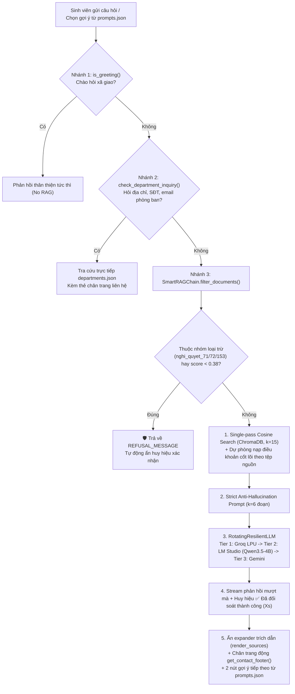

# 🎓 VLUTEBOT - Trợ lý Lucas
### Hệ thống AI Tra cứu Quy chế Đào tạo & Quy định Sinh viên - Trường Đại học Công nghệ Kỹ thuật Vĩnh Long

[](https://streamlit.io/)
[](https://www.langchain.com/)
[](https://www.trychroma.com/)
[](https://groq.com/)
[](https://lmstudio.ai/)
[](https://huggingface.co/bkai-foundation-models/vietnamese-bi-encoder)

---

## 📌 Giới thiệu Dự án
**VLUTEBOT (Trợ lý Lucas)** là ứng dụng hỏi đáp thông minh ứng dụng kỹ thuật **Dynamic RAG (Retrieval-Augmented Generation)**, được thiết kế chuyên biệt cho sinh viên và cán bộ **Trường Đại học Công nghệ Kỹ thuật Vĩnh Long (VLUTE - tiền thân: Trường ĐH Sư phạm Kỹ thuật Vĩnh Long)**.

Hệ thống sử dụng mô hình nhúng tiếng Việt `bkai-foundation-models/vietnamese-bi-encoder` qua `HuggingFaceEmbeddings`, lưu trữ trong **ChromaDB** (`386` đoạn văn bản từ `7` quy chế chính thức) và suy luận đa tầng qua **`RotatingResilientLLM`** (ưu tiên **Groq LPU**, dự phòng **Local LM Studio `qwen/qwen3.5-4b`** và **Gemini**).

Các nhóm quy chế được hỗ trợ tra cứu trực tiếp:
- 🏆 **Học bổng & Khen thưởng:** Tiêu chuẩn, điều kiện tín chỉ, mức học bổng KKHT/SPKT và học bổng vượt khó (**QĐ 201**).
- 💰 **Học phí & Chính sách:** Chế độ miễn giảm học phí, hỗ trợ chi phí học tập (**QĐ 904**) và quy trình hoàn trả học phí thừa (**QT-SV-04**).
- 🤝 **Công tác xã hội (CTXH):** Số ngày tích lũy, phân bổ theo năm học, điều kiện làm khóa luận/tốt nghiệp và quy đổi hoạt động (**QĐ 55**).
- 📋 **Quy chế Công tác sinh viên:** Quyền và nghĩa vụ sinh viên, kỷ luật, chấm dứt hiệu lực kỷ luật và Ban cán sự lớp (**QĐ 1079**).
- 🛡️ **Quy tắc ứng xử & An toàn thông tin:** Văn hóa học đường, trang phục thực hành (**QĐ 367**), mật khẩu, email `@st.vlute.edu.vn` và an ninh mạng (**QĐ 979**).

---

## 🏗️ Kiến trúc Kỹ thuật & Cơ chế Chống Ảo giác



### Các điểm nhấn kiến trúc hiện tại:
1. **3 nhánh xử lý tách bạch trong `app.py`:**
   - **Nhánh 1 (`is_greeting`):** Phản hồi chào hỏi nhanh không cần gọi RAG.
   - **Nhánh 2 (`check_department_inquiry`):** Đọc trực tiếp dữ liệu địa điểm, điện thoại, email từ `departments.json`.
   - **Nhánh 3 (Dynamic RAG):** Chỉ truy xuất vector khi thực sự là câu hỏi nghiệp vụ/quy chế.
2. **Conversational Query Rewriting (`rewrite_conversational_query` trong `rag.py`):**
   - Tự động giữ nguyên câu hỏi gốc khi lịch sử trống hoặc câu hỏi đã đủ chủ ngữ để tránh tăng độ trễ.
   - Khi phát hiện đại từ/từ nối ngữ cảnh (`"nó"`, `"cái đó"`, `"mức này"`, `"vậy thì"`, `"còn hồ sơ"`, `"như thế nào"`...), lấy 2–3 lượt hội thoại gần nhất và dùng `RotatingResilientLLM` (`temperature=0.0, max_tokens=120`) viết lại thành câu hỏi độc lập trước khi truyền vào `SmartRAGChain.filter_documents()` và `get_contact_footer()`, đồng thời vẫn hiển thị nguyên văn câu hỏi gốc trên bong bóng chat.
3. **`SmartRAGChain.filter_documents` trong `rag.py`:**
   - Truy vấn **`similarity_search_with_relevance_scores` 1 lần duy nhất** trên CPU (gộp sẵn từ khóa tăng cường vào `search_query`), lọc theo ngưỡng tương đồng Cosine `SIMILARITY_THRESHOLD = 0.38`.
   - Định tuyến tệp nguồn (`target_source`) và truy xuất dự phòng có kiểm soát (`filter={"source": target_source}`) khi thiếu các điều khoản cốt lõi (học bổng Mức 1/SPKT, hoàn trả học phí `QT-SV-04`, hỗ trợ chi phí học tập `Điều 10–11`, CTXH, công tác sinh viên, ứng xử, ATTT).
   - Loại bỏ hoàn toàn các nghị quyết hành chính (`nghi_quyet_71.pdf`, `nghi_quyet_72.pdf`, `nghi_quyet_153.pdf`) khỏi kết quả và danh sách ingest (`EXCLUDED_FILES`).
4. **`RotatingResilientLLM` đa tầng chịu lỗi & Caching tài nguyên (`@st.cache_resource`):**
   - **Tier 1 (Chính):** **Groq LPU** với cơ chế giữ ấm client (`_GROQ_CLIENTS_CACHE`), bỏ qua nhanh model không khả dụng (`_DEAD_GROQ_MODELS`) và xoay vòng qua các model `openai/gpt-oss-120b`, `qwen/qwen3.8-27b`, `openai/gpt-oss-20b`, `llama-3.3-70b-versatile`, `llama-3.1-8b-instant`, `gemma2-9b-it`. Riêng `rewrite_conversational_query()` ưu tiên model nhẹ tốc độ cao (`llama-3.1-8b-instant` / `qwen/qwen3.8-27b`).
   - **Tier 2 (Dự phòng 1):** **Local LM Studio** (`http://127.0.0.1:1234/v1`, model `qwen/qwen3.5-4b`).
   - **Tier 2 (Dự phòng 2):** **Gemini** (`gemini-2.5-flash`) nếu có key hợp lệ.
   - **Caching tài nguyên:** `get_embedding_model()`, `get_vector_db()`, `get_rag_chain()`, `get_rewriter_llm()`, `load_chain()` đều được cache qua `@st.cache_resource(show_spinner=False)`.
5. **Giao diện Streamlit chuẩn VLUTE (`app.py`):**
   - Header hiển thị logo VLUTE (`logo_vlute.png`), avatar Lucas (`lucas_avatar.png`), và 3 huy hiệu trạng thái.
   - Hiển thị huy hiệu **`✅ Đã đối soát thành công (Xs)`** ở đầu câu trả lời hợp lệ (tự động ẩn khi trả về `REFUSAL_MESSAGE`).
   - **Ẩn hoàn toàn khối `st.expander("📑 CĂN CỨ VĂN BẢN TRÍCH DẪN")`** trong `render_sources()` để giữ khung chat tinh gọn.
   - **Chân trang liên hệ động (`get_contact_footer`):** Hiển thị đúng đơn vị phụ trách và hỗ trợ **tuyến phối hợp liên phòng ban `CTSV – Đào tạo – KHTC`** cho quy trình hoàn trả học phí thừa (`QT-SV-04`).
   - **Sidebar Dark Charcoal đồng bộ động:** Nạp toàn bộ 4 đơn vị trực tiếp từ `departments.json` kèm nút làm mới hội thoại; hệ thống nút gợi ý nhanh (4 nút đầu trang + 2 nút liên quan sau mỗi câu trả lời) đọc từ `prompts.json` với `on_click=submit_user_query`.

---

## 📊 Kết quả Đánh giá Định lượng RAG (`evaluation/eval_results.csv`)

Bộ đánh giá gồm **35 câu hỏi thực tế** (`evaluation/test_dataset.json`): **30 câu trong phạm vi** (phân bổ đều qua 7 văn bản quy chế trong `chroma_db`) và **5 câu ngoài phạm vi / nghị quyết bị loại trừ**, thực thi tự động bằng `evaluation/run_eval.py`.

| Chỉ số đánh giá | Kết quả đo được | Ghi chú |
| :--- | :---: | :--- |
| **Tổng số câu kiểm thử** | **35 câu** | 30 trong phạm vi + 5 ngoài phạm vi |
| **Retrieval Hit Rate (In-scope)** | **100.00% (30/30)** | Truy xuất đúng file PDF gốc cho 100% câu hỏi quy chế |
| **Answer Correctness / Faithfulness** | **4.23 / 5.00** (In-scope) \| **4.34 / 5.00** (Toàn bộ 35 câu) | Chấm điểm 1–5 bằng LLM Judge đối chiếu Ground Truth & Context |
| **Refusal Accuracy (Out-of-scope)** | **100.00% (5/5)** | Từ chối chuẩn xác các câu ngoài phạm vi và `nghi_quyet_*` |
| **Average Latency** | **8.46s** (Toàn bộ) \| **9.87s** (In-scope) | Bao gồm thời gian truy xuất vector và sinh câu trả lời |

---

## 📂 Cấu trúc Thư mục Dự án

```text
D:\VLUTEBOT\
├── .streamlit/
│   ├── config.toml                 # Cấu hình server và giao diện sáng (#00703c)
│   └── secrets.toml                # Lưu API key (GROQ_API_KEY) - không commit
├── data/                           # Kho PDF nguồn (7 quy chế nạp vào DB + 3 nghị quyết bị loại trừ)
│   ├── xet_cap_hoc_bong.pdf
│   ├── quy_dinh_mien_giam_hoc_phi.pdf
│   ├── quy_trinh_hoan_tra_hoc_phi.pdf
│   ├── quy_dinh_cong_tac_sinh_vien.pdf
│   ├── tin_chi_cong_tac_xa_hoi.pdf
│   ├── quy_tac_ung_xu.pdf
│   ├── quy_che_an_toan_thong_tin.pdf
│   ├── nghi_quyet_71.pdf           # Bị loại trừ trong EXCLUDED_FILES
│   ├── nghi_quyet_72.pdf           # Bị loại trừ trong EXCLUDED_FILES
│   └── nghi_quyet_153.pdf          # Bị loại trừ trong EXCLUDED_FILES
├── chroma_db/                      # Vector Database (386 chunks, 768 chiều)
├── evaluation/                     # Bộ đánh giá định lượng RAG
│   ├── test_dataset.json           # 35 câu hỏi kiểm thử + Ground Truth + expected_source
│   ├── run_eval.py                 # Script chạy đánh giá SmartRAGChain & chấm điểm LLM Judge
│   └── eval_results.csv            # Kết quả thực nghiệm chi tiết từng câu
├── app.py                          # Giao diện web Streamlit & điều phối 3 nhánh xử lý
├── rag.py                          # SmartRAGChain, RotatingResilientLLM, HuggingFaceEmbeddings
├── ingest.py                       # Script trích xuất PDF (PyMuPDF) và xây dựng ChromaDB
├── departments.json                # Danh bạ 4 phòng ban/trung tâm dùng cho Sidebar & Footer
├── prompts.json                    # Danh sách gợi ý đầu trang và theo 5 chủ đề
├── requirements.txt                # Danh mục thư viện phụ thuộc
├── logo_vlute.png                  # Logo trường VLUTE
├── lucas_avatar.png                # Avatar trợ lý Lucas
└── README.md                       # Tài liệu tổng quan dự án
```

---

## 🚀 Hướng dẫn Cài đặt & Vận hành

### 1. Yêu cầu Tiên quyết
- **Hệ điều hành:** Windows 10/11, Linux hoặc macOS
- **Python:** Phiên bản 3.10 trở lên (khuyến nghị 3.11 / 3.12)
- **LLM Engine:**
  - **Groq API Key** cấu hình trong `.streamlit/secrets.toml` (`GROQ_API_KEY = "..."`) hoặc biến môi trường `GROQ_API_KEY`.
  - **LM Studio (tùy chọn dự phòng cục bộ):** Bật Local Server tại `http://127.0.0.1:1234/v1` với mô hình `qwen/qwen3.5-4b`.

### 2. Thiết lập Môi trường Ảo & Cài đặt Thư viện
```powershell
cd D:\VLUTEBOT
python -m venv .venv
.\.venv\Scripts\Activate.ps1
pip install -r requirements.txt
```

### 3. Nạp Dữ liệu & Xây dựng Vector Database (Ingestion)
*(Chỉ cần chạy khi thay đổi hoặc bổ sung văn bản quy chế PDF trong thư mục `data/`)*
```powershell
python ingest.py
```

### 4. Khởi chạy Ứng dụng
```powershell
streamlit run app.py --server.port 8501
```
Truy cập trình duyệt tại: **`http://localhost:8501`**

### 5. Chạy Đánh giá Định lượng RAG
```powershell
# Chạy đánh giá tự động 35 câu hỏi RAG và xuất evaluation/eval_results.csv
python evaluation/run_eval.py
```

---

## 📞 Đầu mối Liên hệ Hỗ trợ tại VLUTE (`departments.json`)

- 🏢 **Phòng Đào tạo (VLUTE)** — *Tòa nhà A (Tầng 1)*
  - Điện thoại: `(0270) 3822 140` | Email: `daotao@vlute.edu.vn`
- 🏢 **Phòng Công tác Sinh viên (VLUTE)** — *Tòa nhà A (Phòng A1.102 - Tầng trệt)*
  - Điện thoại: `(0270) 3862 436` | Email: `ctsv@vlute.edu.vn`
- 🏢 **Phòng Kế hoạch - Tài chính (VLUTE)** — *Tòa nhà A (Tầng trệt)*
  - Điện thoại: `(0270) 3822 141` | Email: `khtc@vlute.edu.vn`
- 💻 **Trung tâm Công nghệ Thông tin (VLUTE)** — *Tòa nhà B*
  - Điện thoại: `(0270) 3862 250` | Email: `ttcntt@vlute.edu.vn`

---

## 🏛️ Thông tin Chung & Cổng Dịch vụ Trực tuyến

- **Tên trường:** Trường Đại học Công nghệ Kỹ thuật Vĩnh Long *(tiền thân: Trường Đại học Sư phạm Kỹ thuật Vĩnh Long)*
- **Tên tiếng Anh:** Vinh Long University of Technology and Engineering (VLUTE)
- **Địa chỉ:** Số 73 Nguyễn Huệ, Phường Long Châu, Tỉnh Vĩnh Long
- **Điện thoại:** `(0270) 3822 141` | **Fax:** `(0270) 3821 003`
- **Email:** `spktvl@vlute.edu.vn` | **Website:** [vlute.edu.vn](https://vlute.edu.vn/)

### Dịch vụ Tiện ích & Truy cập Nhanh
- 🌐 **My VLUTE:** [vlute.edu.vn](https://vlute.edu.vn/)
- 🎯 **Tuyển sinh:** [tuyensinh.vlute.edu.vn](https://tuyensinh.vlute.edu.vn/)
- 👥 **Công tác Sinh viên:** [cgtdt-dsa.vlute.edu.vn](http://cgtdt-dsa.vlute.edu.vn/)
- 📋 **Phòng Đào tạo:** [pdt.vlute.edu.vn](http://pdt.vlute.edu.vn/)
- 📝 **Đăng ký Học phần:** [daotao.vlute.edu.vn/sinh-vien](https://daotao.vlute.edu.vn/sinh-vien)
- 🖥️ **Hệ thống Quản lý:** [htql.vlute.edu.vn](https://htql.vlute.edu.vn/)
- 💻 **E-Learning:** [elearning.vlute.edu.vn](https://elearning.vlute.edu.vn/)
- 💳 **Cổng Thanh toán:** [thanhtoan.vlute.edu.vn](https://thanhtoan.vlute.edu.vn/)

---
*© Bản quyền thuộc về Trường Đại học Công nghệ Kỹ thuật Vĩnh Long (VLUTE - tiền thân: Trường ĐH Sư phạm Kỹ thuật Vĩnh Long) | Copyright belongs to Vinh Long University of Technology and Engineering.*
