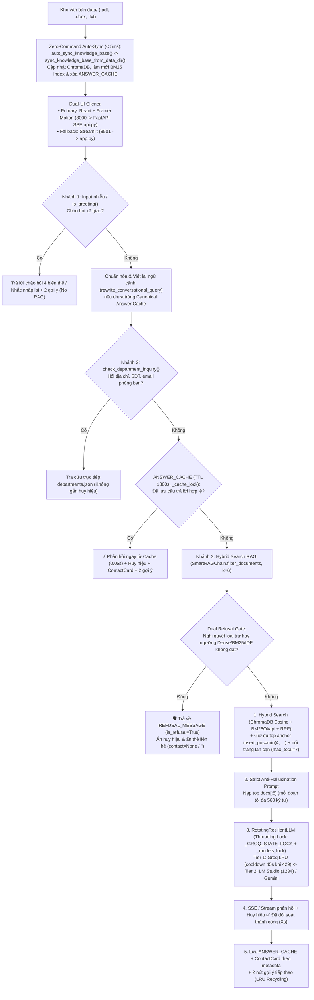

# 🎓 VLUTEBOT - Trợ lý Lucas
### Hệ thống AI Tra cứu Quy chế Đào tạo & Quy định Sinh viên — Trường Đại học Công nghệ Kỹ thuật Vĩnh Long

[](https://fastapi.tiangolo.com/)
[](https://react.dev/)
[-FF4B4B?style=flat&logo=streamlit)](https://streamlit.io/)
[](https://www.langchain.com/)
[](https://www.trychroma.com/)
[](https://groq.com/)
[](https://lmstudio.ai/)
[](https://huggingface.co/bkai-foundation-models/vietnamese-bi-encoder)

---

## 📌 Giới thiệu Dự án
**VLUTEBOT (Trợ lý Lucas)** là hệ thống hỏi đáp quy chế đào tạo và công tác sinh viên ứng dụng kiến trúc **Dual-UI** và lõi **Hybrid RAG (Dense Vector + BM25 + RRF)**, phục vụ sinh viên và cán bộ **Trường Đại học Công nghệ Kỹ thuật Vĩnh Long (VLUTE — tiền thân: Trường ĐH Sư phạm Kỹ thuật Vĩnh Long)**:
- **Giao diện Chính (Production):** Backend **FastAPI + SSE Streaming** ([`api.py`](api.py)) phục vụ SPA **React + Tailwind CSS + Framer Motion** ([`frontend/`](frontend/)) trên cổng **`8000`**.
- **Giao diện Dự phòng (Fallback):** Ứng dụng **Streamlit** ([`app.py`](app.py)) trên cổng **`8501`**, dùng chung lõi RAG, logic định tuyến phòng ban và quy tắc ẩn thẻ liên hệ khi từ chối OOS.

Hệ thống nhúng văn bản bằng `bkai-foundation-models/vietnamese-bi-encoder`, lập chỉ mục **`386` đoạn trích** từ **`7` văn bản quy chế chính thức** trong **ChromaDB**, kết hợp **BM25Okapi** và **`RotatingResilientLLM`** đa tầng an toàn luồng (**Groq LPU** chính $\rightarrow$ **Local LM Studio `qwen/qwen3.5-4b`** $\rightarrow$ **Gemini `gemini-2.5-flash`**).

Các nhóm quy chế được hỗ trợ tra cứu trực tiếp:
- 🏆 **Học bổng & Khen thưởng:** Tiêu chuẩn, điều kiện tín chỉ, mức học bổng KKHT/SPKT và học bổng vượt khó (**QĐ 201**).
- 💰 **Học phí & Chính sách:** Chế độ miễn giảm học phí, hỗ trợ chi phí học tập (**QĐ 904**) và quy trình hoàn trả học phí thừa (**QT-SV-04**).
- 🤝 **Công tác xã hội (CTXH):** Số ngày tích lũy, phân bổ theo năm học, điều kiện làm khóa luận/tốt nghiệp và quy đổi hoạt động (**QĐ 55**).
- 📋 **Quy chế Công tác sinh viên:** Quyền và nghĩa vụ sinh viên, kỷ luật, chấm dứt hiệu lực kỷ luật và Ban cán sự lớp (**QĐ 1079**).
- 🛡️ **Quy tắc ứng xử & An toàn thông tin:** Văn hóa học đường, trang phục thực hành (**QĐ 367**), mật khẩu, email `@st.vlute.edu.vn` và an ninh mạng (**QĐ 979**).

---

## 🏗️ Kiến trúc Dual-UI & Cơ chế Chống Ảo giác



### Các điểm nhấn kỹ thuật chính:
1. **Kiến trúc Dual-UI đồng bộ 100% logic (`api.py` + `frontend/` & `app.py`):**
   - **FastAPI + React (`api.py`, cổng `8000`):**
     - Cung cấp các endpoint `/api/health`, `/api/init`, `/api/prompts/shuffle`, `/api/chat/stream` (SSE `chunk` / `meta` / `done`) và mount trực tiếp bản build tĩnh `frontend/dist/`.
     - Dùng `threading.Lock()` (`_chain_lock`, `_cache_lock`, `_greeting_lock`) bảo vệ khởi tạo singleton `SmartRAGChain`, bộ nhớ đệm `ANSWER_CACHE` (`TTL = 1800s`) và biến đếm câu chào dưới tải đồng thời.
     - Giao diện React 18 + Tailwind CSS + Framer Motion (`60fps`), thanh Sidebar Dark Charcoal (`#1d262a`) mặc định rộng `420px` (kéo giãn linh hoạt `240–600px`), hiển thị đầy đủ 2 nhóm nút `HỆ THỐNG HỌC TẬP` & `ĐƠN VỊ HỖ TRỢ`, thẻ `ĐẦU MỐI LIÊN HỆ PHÒNG BAN` đọc động từ `departments.json`, bong bóng chat chống XSS, và hỗ trợ Responsive Mobile Drawer.
   - **Streamlit Fallback (`app.py`, cổng `8501`):**
     - Dùng chung lõi `rag.py`, đồng bộ toàn bộ phân nhánh chào hỏi, tra cứu danh bạ phòng ban, viết lại câu hỏi nối tiếp, `ANSWER_CACHE`, 4/24 gợi ý ngẫu nhiên + LRU Recycling, và **ẩn thẻ liên hệ phòng ban ở toàn bộ nhánh từ chối ngoài phạm vi (`is_refusal == True`)** giống hệt `api.py`.
2. **Tự động đồng bộ kho văn bản (`Zero-Command Auto-Sync` trong `ingest.py` & `rag.py`):**
   - Hỗ trợ trích xuất `.pdf` (`PyMuPDF`), `.docx` (`python-docx`, cả văn bản và bảng biểu) và `.txt`.
   - Khi khởi tạo/truy vấn, `auto_sync_knowledge_base()` kiểm tra chữ ký thư mục `data/` (`< 5ms` khi không đổi). Nếu có file mới/sửa/xóa, hệ thống tự cập nhật tăng cường ChromaDB, làm mới chỉ mục BM25 (`get_bm25_index`) và xóa `ANSWER_CACHE`.
   - Loại trừ có chủ đích 3 nghị quyết hành chính (`nghi_quyet_71.pdf`, `nghi_quyet_72.pdf`, `nghi_quyet_153.pdf`) qua `EXCLUDED_FILES` / `EXCLUDED_SOURCE_FILES`.
3. **Hybrid Search RRF & Cấu hình ngữ cảnh `max_total=7` / `docs[:5]` (`rag.py`):**
   - Kết hợp **Dense Vector Search** (`ChromaDB`, `HYBRID_DENSE_WEIGHT=1.0`, `HYBRID_SIM_FLOOR=0.39`, `SIMILARITY_THRESHOLD=0.38`) và **Lexical Search** (`rank_bm25.BM25Okapi`, `HYBRID_BM25_WEIGHT=1.35`, `HYBRID_RRF_K=20`).
   - **Tách vế câu hỏi ghép (`_split_compound_clauses`):** Truy xuất song song cho câu đầy đủ và các vế độc lập rồi trộn xen kẽ (*round-robin*) tối đa `7` đoạn.
   - **Giữ anchor & nối đoạn lân cận (`filter_documents`):** Chèn các đoạn lân cận cùng trang/liền kề tại vị trí **`insert_pos = min(4, len(selected_indices))`** để 4 anchor đứng đầu luôn nằm trọn trong **`docs[:5]`**, giới hạn tổng danh sách truy xuất ở **`max_total = 7`**, và đưa top **`docs[:5]`** (tối đa `MAX_CONTEXT_SNIPPET_CHARS = 560` ký tự/đoạn) vào prompt để vừa bảo đảm đủ căn cứ liên trang vừa tối ưu tốc độ & hạn mức TPM của LLM.
   - **Dual Refusal Gate:** Từ chối an toàn bằng `REFUSAL_MESSAGE` và ẩn huy hiệu đối soát + ẩn thẻ liên hệ khi câu hỏi thuộc danh sách loại trừ hoặc không đạt ngưỡng tin cậy Dense/BM25/IDF.
4. **An toàn luồng & LLM đa tầng (`RotatingResilientLLM` trong `rag.py`):**
   - **Bảo vệ đồng thời (`threading.Lock`):** Dùng `_GROQ_STATE_LOCK` bảo vệ chỉ số key xoay vòng (`_CURRENT_KEY_INDEX`, `_CURRENT_GROQ_KEY_INDEX`), tập model ngưng hoạt động (`_DEAD_GROQ_MODELS`), bảng cooldown 45s (`_COOLDOWN_GROQ_MODELS`) và cache client (`_GROQ_CLIENTS_CACHE`); đồng thời dùng `self._models_lock` bảo vệ mọi thao tác đọc/thăng hạng/xoay vòng `self._groq_models` và `self._cloud_clients` khi chịu tải `429` song song cao.
   - **Tier 1 (Chính):** **Groq LPU** xoay vòng `openai/gpt-oss-120b`, `qwen/qwen3-32b`, `openai/gpt-oss-20b`, `llama-3.3-70b-versatile`, `llama-3.1-8b-instant` (riêng bước viết lại câu hỏi nối tiếp ưu tiên `llama-3.1-8b-instant` với `max_output_tokens=100`).
   - **Tier 2 (Dự phòng 1):** **Local LM Studio** (`http://127.0.0.1:1234/v1`, model `qwen/qwen3.5-4b`, tự kiểm tra cổng nhanh trước khi gọi).
   - **Tier 2 (Dự phòng 2):** **Gemini** (`gemini-2.5-flash`) nếu cấu hình key hợp lệ (`AIzaSy...`).

---

## 📊 Kết quả Đánh giá Định lượng RAG

### 1. Bộ Benchmark toàn diện 700 câu (`evaluation/run_benchmark_700.py`)
Kiểm thử toàn diện Tầng 1 Hybrid Search + định tuyến phòng ban trên **700 câu hỏi** (`100` câu / văn bản × `7` quy chế; kết quả chi tiết lưu tại [`evaluation/benchmark_700_results.csv`](evaluation/benchmark_700_results.csv)):

| Tập văn bản kiểm thử (100 câu / file) | Hit@k | Top-1 Accuracy | Dept Routing OK | False Refusal | Avg (ms) | p95 (ms) | Max (ms) |
| :--- | :---: | :---: | :---: | :---: | :---: | :---: | :---: |
| `xet_cap_hoc_bong.pdf` | 99.0% | 97.0% | 98.0% | 1 | 79.60 | 126.65 | 231.99 |
| `quy_dinh_mien_giam_hoc_phi.pdf` | 100.0% | 99.0% | 99.0% | 0 | 195.85 | 319.62 | 632.98 |
| `quy_trinh_hoan_tra_hoc_phi.pdf` | 100.0% | 97.0% | 97.0% | 0 | 209.69 | 279.75 | 353.49 |
| `quy_dinh_cong_tac_sinh_vien.pdf` | 99.0% | 90.0% | 98.0% | 1 | 232.45 | 446.74 | 636.99 |
| `tin_chi_cong_tac_xa_hoi.pdf` | 99.0% | 99.0% | 99.0% | 1 | 244.34 | 581.62 | 727.94 |
| `quy_tac_ung_xu.pdf` | 93.0% | 87.0% | 92.0% | 7 | 196.16 | 298.20 | 374.62 |
| `quy_che_an_toan_thong_tin.pdf` | 99.0% | 98.0% | 98.0% | 1 | 206.13 | 302.76 | 539.69 |
| **TỔNG HỢP 700 CÂU** | **98.43%** | **95.29%** | **97.29%** | **11** | **194.89** | **313.64** | **727.94** |

### 2. Các bộ kiểm thử bổ sung trong `evaluation/`
- **Stress test 70 câu & Baseline 35 câu (`evaluation/run_stress_test_70.py`):** Bộ kiểm thử nhanh theo bảng biểu/phụ lục (`stress_test_70.json`, `test_dataset.json`, xuất ra `stress_test_70_results.csv`).
- **Đánh giá End-to-End LLM Judge (`evaluation/run_eval.py`):** Chấm điểm chất lượng trả lời thực tế 35 câu (`test_dataset.json`, xuất ra `eval_results.csv`).

---

## 📂 Cấu trúc Thư mục Dự án

```text
D:\VLUTEBOT\
├── .streamlit/
│   ├── config.toml                  # Cấu hình Streamlit
│   └── secrets.toml                 # API keys (GROQ_API_KEY / GROQ_API_KEYS) - đã loại khỏi Git
├── chroma_db/                       # Vector Database (386 chunks, 768 chiều)
├── data/                            # Kho tài liệu nguồn (.pdf, .docx, .txt; 7 quy chế nạp DB + 3 nghị quyết loại trừ)
│   ├── xet_cap_hoc_bong.pdf
│   ├── quy_dinh_mien_giam_hoc_phi.pdf
│   ├── quy_trinh_hoan_tra_hoc_phi.pdf
│   ├── quy_dinh_cong_tac_sinh_vien.pdf
│   ├── tin_chi_cong_tac_xa_hoi.pdf
│   ├── quy_tac_ung_xu.pdf
│   ├── quy_che_an_toan_thong_tin.pdf
│   ├── nghi_quyet_71.pdf            # Loại trừ bởi EXCLUDED_FILES
│   ├── nghi_quyet_72.pdf            # Loại trừ bởi EXCLUDED_FILES
│   └── nghi_quyet_153.pdf           # Loại trừ bởi EXCLUDED_FILES
├── evaluation/                      # Bộ kiểm thử RAG & định tuyến phòng ban
│   ├── run_benchmark_700.py         # Benchmark 700 câu (98.43% Hit@k, 97.29% Dept OK)
│   ├── benchmark_700_per_doc.json   # Bộ 700 câu hỏi sinh theo từng quy chế
│   ├── benchmark_700_results.csv    # Kết quả chi tiết 700 câu
│   ├── run_stress_test_70.py        # Benchmark nhanh 70 + 35 câu
│   ├── run_eval.py                  # Đánh giá E2E bằng LLM Judge
│   ├── stress_test_70.json
│   └── test_dataset.json
├── frontend/                        # SPA React + Vite + Tailwind + Framer Motion
│   ├── src/
│   │   ├── App.jsx                  # Luồng chat SSE, Resizable Sidebar (420px), Error/Abort recovery
│   │   ├── index.css                # Biến giao diện & lưới chấm bi VLUTE
│   │   ├── main.jsx
│   │   └── components/
│   │       ├── ChatMessage.jsx      # Bong bóng chat, huy hiệu đối soát, 2 nút gợi ý
│   │       ├── ContactCard.jsx      # Thẻ liên hệ đơn vị & tuyến phối hợp 3 bước
│   │       ├── HeroHeader.jsx       # Header VLUTE & avatar Lucas
│   │       ├── Sidebar.jsx          # Bảng điều khiển học vụ, link nhanh & danh bạ
│   │       └── WelcomePrompts.jsx   # Lưới gợi ý 2×2 & nút đổi gợi ý
│   ├── index.html
│   ├── package.json                 # React 18.3, Framer Motion 11.15, Tailwind 3.4, Vite 5.4
│   ├── tailwind.config.js
│   └── vite.config.js
├── api.py                           # Backend FastAPI chính (cổng 8000): SSE, Answer Cache, serve frontend/dist/
├── app.py                           # Giao diện Streamlit dự phòng (cổng 8501), đồng bộ OOS & định tuyến
├── rag.py                           # SmartRAGChain (max_total=7, docs[:5]), RotatingResilientLLM (thread-safe), Auto-Sync
├── ingest.py                        # Trích xuất .pdf/.docx/.txt, gán metadata phòng ban & đồng bộ ChromaDB
├── departments.json                 # Danh bạ 4 đơn vị: dao_tao, ctsv, khtc, cntt
├── prompts.json                     # 4 gợi ý khởi tạo & 24 gợi ý theo 4 nhóm chuyên đề
├── requirements.txt                 # Thư viện Python (Streamlit, FastAPI, Uvicorn, LangChain, ChromaDB, BM25...)
├── logo_vlute.png                   # Logo trường VLUTE
├── lucas_avatar.png                 # Avatar trợ lý Lucas (96×96px)
├── .gitignore                       # Loại trừ .venv/, node_modules/, frontend/node_modules/, frontend/dist/, *.log, secrets
└── README.md                        # Tài liệu tổng quan dự án
```

---

## 🚀 Hướng dẫn Cài đặt & Khởi động Nhanh

### 1. Yêu cầu Tiên quyết
- **Hệ điều hành:** Windows 10/11, Linux hoặc macOS
- **Python:** Phiên bản 3.10 trở lên (khuyến nghị 3.11 / 3.12)
- **Node.js:** Phiên bản 18 trở lên (chỉ cần khi chỉnh sửa/build lại giao diện React trong `frontend/`)
- **LLM Engine:**
  - **Groq API Key:** cấu hình `GROQ_API_KEY` (hoặc `GROQ_API_KEYS`) trong `.streamlit/secrets.toml` hoặc biến môi trường hệ thống.
  - **LM Studio (tùy chọn dự phòng cục bộ):** Bật Local Server tại `http://127.0.0.1:1234/v1` với mô hình `qwen/qwen3.5-4b`.

### 2. Cài đặt Môi trường Python & Build Frontend
```powershell
cd D:\VLUTEBOT
python -m venv .venv
.\.venv\Scripts\Activate.ps1
pip install -r requirements.txt
```

Build giao diện React thành bản tĩnh phục vụ bởi FastAPI (`frontend/dist/`):
```powershell
cd frontend
npm install
npm run build
cd ..
```

### 3. Khởi chạy Giao diện Chính (FastAPI + React — Cổng `8000`)
```powershell
uvicorn api:app --host 127.0.0.1 --port 8000
```
Truy cập trình duyệt tại: **`http://127.0.0.1:8000`** *(tài liệu API tự động tại `/docs`, kiểm tra tình trạng tại `/api/health`)*.

> **Chế độ phát triển Frontend (Vite HMR):** Chạy song song `uvicorn api:app --host 127.0.0.1 --port 8000` và `cd frontend && npm run dev`.

### 4. Khởi chạy Giao diện Dự phòng (Streamlit — Cổng `8501`)
```powershell
streamlit run app.py --server.port 8501
```
Truy cập trình duyệt tại: **`http://localhost:8501`**

### 5. Nạp dữ liệu & Chạy Kiểm thử Benchmark 700 câu
- **Tự động đồng bộ (`Auto-Sync`):** Chỉ cần thêm/sửa/xóa file `.pdf`, `.docx`, `.txt` trong `data/`; hệ thống tự động cập nhật ChromaDB và BM25 ngay ở lần gọi kế tiếp.
- **Tái lập ChromaDB từ đầu (tùy chọn):**
  ```powershell
  python ingest.py
  ```
- **Chạy Benchmark 700 câu (Truy xuất + Định tuyến phòng ban):**
  ```powershell
  python evaluation/run_benchmark_700.py
  ```
- **Chạy Stress-test 70 câu / Đánh giá E2E 35 câu:**
  ```powershell
  python evaluation/run_stress_test_70.py
  python evaluation/run_eval.py
  ```

---

## 📞 Đầu mối Liên hệ Hỗ trợ tại VLUTE (`departments.json`)

- 🏢 **Phòng Đào tạo (VLUTE)** *(Tên đầy đủ trên cổng thông tin: Phòng Đào tạo - Đảm bảo chất lượng)* — *Tòa nhà A (Tầng 1)*
  - Điện thoại: `(0270) 3822 140` | Email: `daotao@vlute.edu.vn`
- 🏢 **Phòng Công tác Sinh viên (VLUTE)** *(Tên đầy đủ trên cổng thông tin: Phòng Công tác sinh viên và Truyền thông)* — *Tòa nhà A (Phòng A1.102 - Tầng trệt)*
  - Điện thoại: `(0270) 3862 436` | Email: `ctsv@vlute.edu.vn`
- 🏢 **Phòng Kế hoạch - Tài chính (VLUTE)** — *Tòa nhà A (Tầng trệt)*
  - Điện thoại: `(0270) 3822 141` | Email: `khtc@vlute.edu.vn`
- 💻 **Trung tâm Công nghệ Thông tin (VLUTE)** — *Tòa nhà B*
  - Điện thoại: `(0270) 3862 250` | Email: `ttcntt@vlute.edu.vn`

---

## 🏛️ Thông tin Chung & Cổng Dịch vụ Trực tuyến

- **Tên trường:** Trường Đại học Công nghệ Kỹ thuật Vĩnh Long *(tiền thân: Trường Đại học Sư phạm Kỹ thuật Vĩnh Long)*
- **Tên tiếng Anh:** Vinh Long University of Technology and Engineering (VLUTE)
- **Địa chỉ:** Số 73 Nguyễn Huệ, Phường Long Châu, Tỉnh Vĩnh Long
- **Website:** [vlute.edu.vn](https://vlute.edu.vn/)

### Cổng Hệ thống Học tập & Đơn vị Hỗ trợ
- 🌐 **My VLUTE:** [vlute.edu.vn](https://vlute.edu.vn/)
- 📝 **ĐK Học phần:** [daotao.vlute.edu.vn/sinh-vien](https://daotao.vlute.edu.vn/sinh-vien)
- 💻 **E-Learning:** [elearning.vlute.edu.vn](http://elearning.vlute.edu.vn/)
- 💳 **Thanh toán:** [thanhtoan.vlute.edu.vn](https://thanhtoan.vlute.edu.vn/)
- 🎯 **Tuyển sinh:** [tuyensinh.vlute.edu.vn](https://tuyensinh.vlute.edu.vn/)
- 📋 **Đào tạo (A1.101 — Phòng Đào tạo - Đảm bảo chất lượng):** [pdt.vlute.edu.vn](http://pdt.vlute.edu.vn/)
- 👥 **CTSV (A1.102 — Phòng Công tác sinh viên và Truyền thông):** [cgtdt-dsa.vlute.edu.vn](http://cgtdt-dsa.vlute.edu.vn/)
- 💰 **KHTC (Tầng trệt — Phòng Kế hoạch - Tài chính):** [vlute.edu.vn/phong-ke-hoach-tai-chinh](https://vlute.edu.vn/phong-ke-hoach-tai-chinh)

---
*© Bản quyền thuộc về Trường Đại học Công nghệ Kỹ thuật Vĩnh Long (VLUTE — tiền thân: Trường ĐH Sư phạm Kỹ thuật Vĩnh Long) | Copyright belongs to Vinh Long University of Technology and Engineering.*
